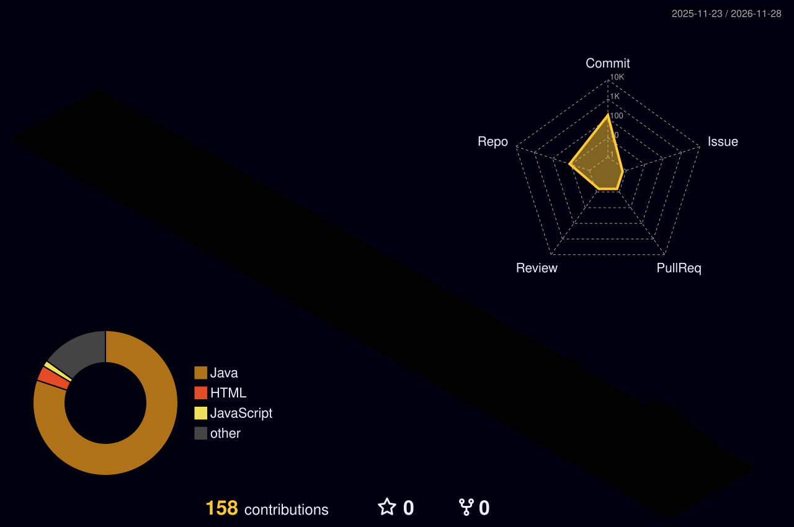

<!-- Animated header -->

  

<!-- Typing animation -->

  

  
  
  
  

## 👨‍💻 About Me
- 🎓 B.Tech graduate (AKTU, 2026)
- 💻 Java Full Stack training at JSpider
- ⚙️ Building backend projects with **Java, Spring Boot, Hibernate, MySQL**
- 🌱 Solving DSA in Java daily
- 💼 Open to **Java Developer / Full Stack fresher roles**
- 📫 Reach me: tanuj.656565@gmail.com

## 🛠️ Tech Stack

  

## 🧩 LeetCode Stats

  

## 📊 GitHub Stats

  
  

  

## 🧊 3D Contribution Graph

  

## 🐍 Contribution Snake

  

## 📌 Featured Projects
| Project | Tech | What it does |
|---|---|---|
| [Zepto Backend](https://github.com/Tanuj-1/ZEPTO-Backend-using-Java-) | Java, JDBC, MySQL | Quick-commerce backend |
| [DSA-JAVA](https://github.com/Tanuj-1/DSA-JAVA) | Java | Solved DSA problems |

  

